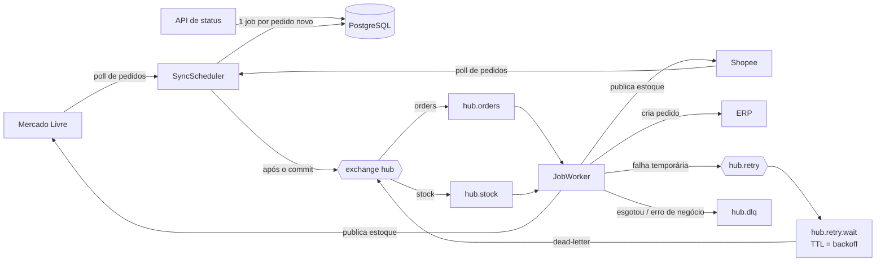

# Integration Hub

[](https://github.com/efvieira/integration-hub/actions/workflows/ci.yml)
[](https://github.com/efvieira/integration-hub/actions/workflows/cd.yml)


[](LICENSE)

Hub que **sincroniza pedidos e estoque entre marketplaces (Mercado Livre, Shopee) e o ERP** da loja. Os pedidos que entram nos marketplaces viram pedidos de venda no ERP, e o saldo de estoque do ERP é publicado em todos os canais.

Integração quebra o tempo todo: API fora do ar, limite de requisições, SKU não cadastrado. Por isso o foco aqui é o que acontece quando dá errado. O hub usa fila, retentativa com backoff exponencial, fila de falhas, reprocessamento e uma API de status para o painel.

### ✨ Destaques

- 🔌 **Conectores plugáveis** (`MarketplaceConnector`): adaptador real do Mercado Livre (API pública) e assinatura HMAC da Shopee Open Platform v2; sem credenciais, cada canal usa um sandbox em memória
- 📨 **RabbitMQ** com fila de espera por TTL e dead-letter, que dá **backoff exponencial sem plugin**
- 🧯 **Fila de falhas (DLQ)** e reprocessamento individual ou em lote depois que o sistema externo volta
- 🧬 **Sem duplicidade**: restrição única por canal e pedido no banco, leitura com sobreposição, ERP idempotente pela referência externa
- 🚦 **Falha temporária × erro de negócio**: timeout e 5xx tentam de novo; SKU inexistente falha na hora, sem gastar tentativas
- 📊 **API de status** por canal: última leitura, último erro e jobs por situação
- 🧵 **Java 25** com records, pattern matching e virtual threads

### 🛠️ Stack

Java 25 · Spring Boot 4.1 · Spring AMQP · RabbitMQ 4 · Spring Data JPA · Flyway · PostgreSQL · RestClient · springdoc-openapi · JUnit 5 · MockRestServiceServer · JaCoCo · Docker · GitHub Actions

## 🏗️ Arquitetura



## 🧠 Decisões técnicas

| Decisão | Por quê |
|---|---|
| A mensagem leva só o id do job | O estado (tentativas, erro, resultado) fica no banco, consultável pelo painel. Reentregas da fila são inofensivas, porque o job já `DONE` é ignorado. |
| Publicar na fila só depois do commit | Evita o worker buscar um job que ainda não foi gravado, ou que sofreu rollback. |
| Backoff com TTL + dead-letter | O RabbitMQ não tem atraso nativo sem plugin. A mensagem espera numa fila sem consumidores até expirar e volta para a exchange original. |
| Leitura com sobreposição de 2 min | Pedidos criados durante uma leitura não se perdem. A duplicata resultante é barrada pela restrição única. |
| Erro de negócio não é retentado | Tentar 5 vezes criar um pedido com SKU inexistente só atrasa o alerta. |
| Canal fora do ar não para os outros | Cada conector é lido de forma isolada, e o erro fica registrado no cursor do canal. |

## 🚀 Como rodar

```bash
docker compose up -d --build
```

| Serviço | URL |
|---|---|
| Swagger | http://localhost:8080/swagger-ui.html |
| Painel do RabbitMQ | http://localhost:15672 (guest/guest) |

### Demonstração de falha e reprocessamento

```bash
# Um pedido chega na Shopee
curl -X POST localhost:8080/sandbox/SHOPEE/orders -H 'Content-Type: application/json' \
  -d '{"externalId":"SH-1","buyerName":"Ana","lines":[{"sku":"CANECA-300","quantity":1,"unitPrice":59.90}]}'

# Derrube o ERP: o job tenta 5 vezes (5s, 10s, 20s, 40s) e vai para a fila de falhas
curl -X POST 'localhost:8080/sandbox/erp?online=false'
curl 'localhost:8080/jobs?status=FAILED'

# ERP de volta: reprocessa tudo que falhou
curl -X POST 'localhost:8080/sandbox/erp?online=true'
curl -X POST localhost:8080/jobs/retry-failed
curl localhost:8080/status
```

### Testes

```bash
./mvnw verify
```

## 📡 Endpoints

| Método | Rota | Descrição |
|---|---|---|
| `GET` | `/status` | Situação de cada canal |
| `GET` | `/jobs?status=FAILED` | Jobs recentes (filtro opcional por situação) |
| `POST` | `/jobs/{id}/retry` | Reprocessa um job com falha |
| `POST` | `/jobs/retry-failed` | Reprocessa todos os jobs com falha |
| `POST` | `/sandbox/{canal}/orders` | Simula um pedido novo no marketplace |
| `GET` | `/sandbox/{canal}/stock` | Estoque publicado no canal simulado |
| `POST` | `/sandbox/erp?online=` | Liga/desliga o ERP simulado |

## 🗺️ Próximos passos

- [ ] Painel web em repositório próprio (`integration-hub-web`) consumindo `/status` e `/jobs`
- [ ] Adaptador real da Shopee (a assinatura já está pronta em `ShopeeSigner`)
- [ ] Conector de ERP real (Bling ou Tiny) e webhooks dos marketplaces no lugar do polling
- [ ] ShedLock para rodar o agendador em mais de uma instância
- [ ] Alertas quando a DLQ passar de um limite

## 🔀 Fluxo de branches e CI/CD

`develop` (padrão) → `release` → `master`, sempre por PR. Detalhes em [CONTRIBUTING.md](CONTRIBUTING.md).

## 📄 Licença

[MIT](LICENSE)
